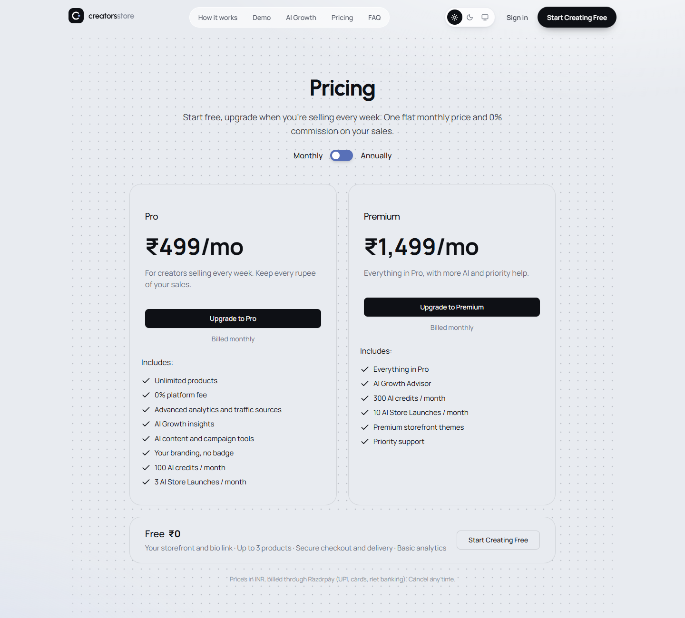

# Creators Store

A storefront for Indian creators who sell coaching, programs and guides. Buyers pay into the creator's own Razorpay account, and the platform takes **0% commission** on every plan.

**Live:** https://www.creators-store.site

**[▶ Watch the walkthrough](https://anuj1102001.github.io/creators-store-showcase/watch.html)** (1 min 38 s, narrated with a synthetic voice): sign up, build a store, add a product, take a test payment, see the order and analytics. Recorded on a local build with demo data and a test payment gateway.

## Why it's different

Most creator-commerce tools take a percentage of every sale, or collect the money and pay creators out later. Creators Store does neither:

- **The creator's own Razorpay.** Creators connect their Razorpay account once. Checkout runs on their account, and Razorpay settles to their bank.
- **0% commission.** The platform earns from a flat subscription: Free ₹0, Pro ₹499/month, Premium ₹1,499/month (annual billing gives 2 months free).
- **India-first.** INR pricing, UPI, cards, net banking and wallets, built for creators who sell on Instagram.

| Pricing | Dark mode | Mobile |
|---|---|---|
|  |  |  |

## Features

- **Store builder:** templates, colours, typography, sections, SEO, live mobile/desktop preview, publish/unpublish
- **Products:** digital downloads with private files, coaching, consultations, services, external links
- **Checkout:** UPI, cards, net banking via the creator's Razorpay; orders fulfilled only after server-side verification; instant delivery and receipt emails
- **Reliability:** reconciliation for buyers who close the tab (on page load and a scheduled job); optional per-creator webhooks, treated as hints and re-verified
- **Orders and customers:** refunds, CSV export, customer CRM, newsletter subscribers
- **Analytics:** visitors, sources and UTM, funnel, conversion, revenue
- **AI tools:** store launch, product copy, content and campaign assistants, growth insights (currently a clearly labelled demo mode until a model API key is configured)
- **Admin:** users, subscriptions, GMV, MRR/ARR, churn, system health, error and audit logs
- **Light, dark and match-device themes** across the dashboard and marketing site

## Tech stack

Next.js 15 (App Router, server actions) · React 19 · TypeScript · Tailwind CSS · PostgreSQL (Neon) · Drizzle ORM · Zod · Razorpay REST API · Resend · Vercel Blob · Vercel (Singapore region)

Security highlights: bcrypt passwords and revocable hashed sessions, Zod validation on every input, CSP/HSTS headers, rate limits, AES-256-GCM encryption for stored payment credentials, idempotent payment handling.

How it fits together: [ARCHITECTURE.md](ARCHITECTURE.md).

## Quality

- 27 automated tests on an in-memory Postgres covering checkout, payment verification, tampered amounts, forged signatures, refunds, webhooks, subscriptions and creator payment connections
- Full documentation for setup, deployment, operations, customization and handover

## Status

- Live on its own domain; email sending and support inbox working
- End-to-end purchase tested on production in Razorpay test mode
- Early stage: no paying customers yet

## Source code

This repository is a public showcase. The application source is private.

Interested in the product, a partnership or an acquisition? Write to **support@creators-store.site**.

© Creators Store. All rights reserved.
