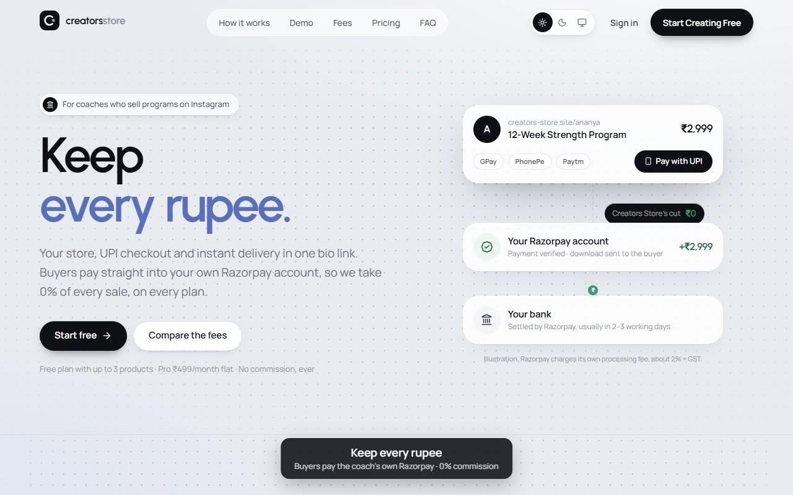
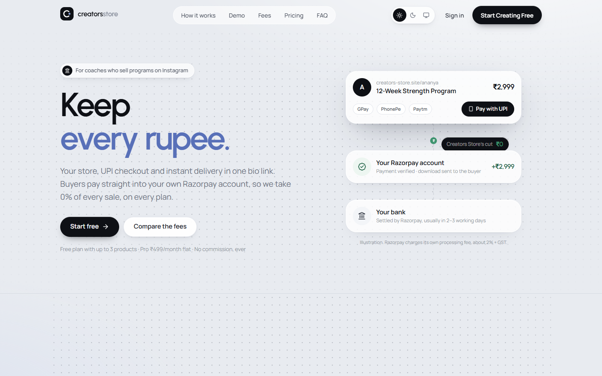
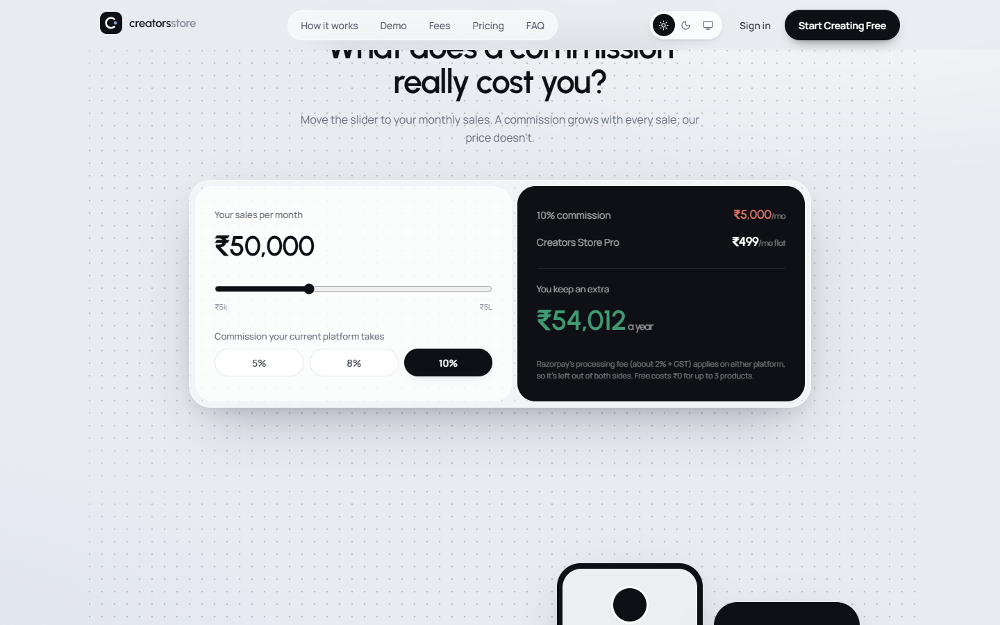
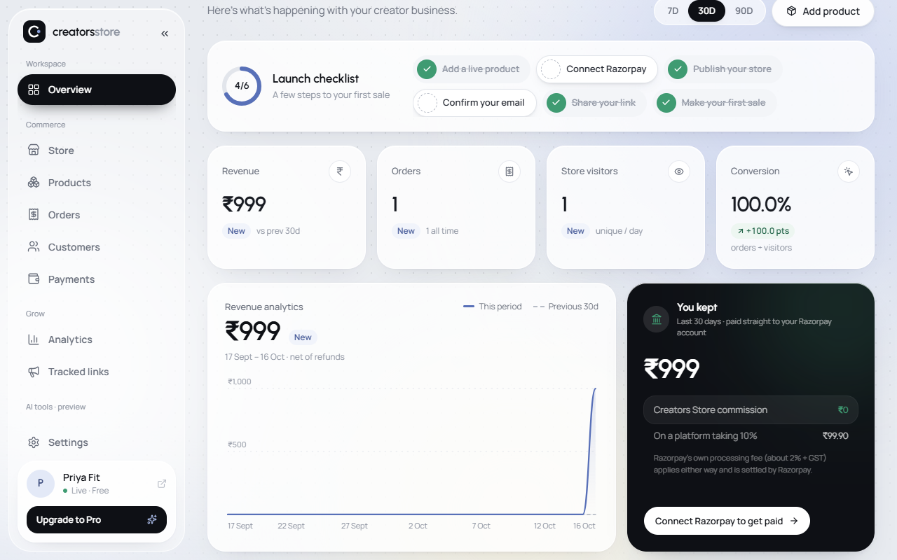
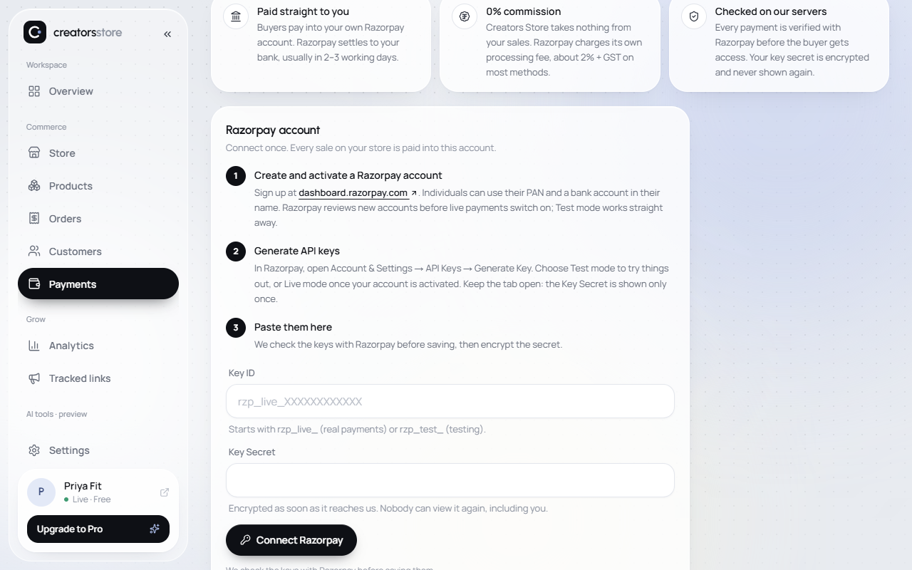
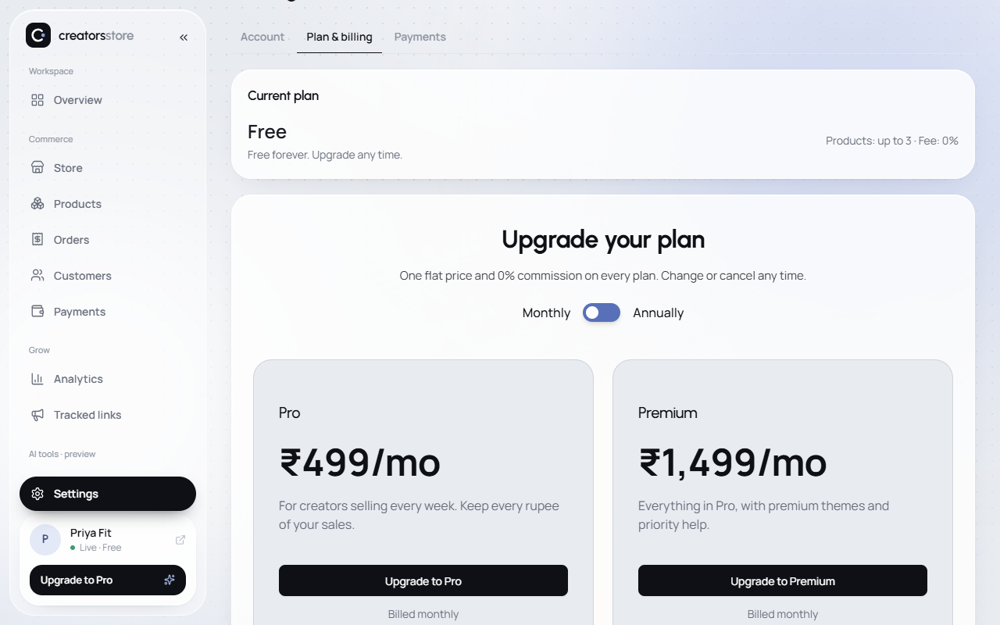
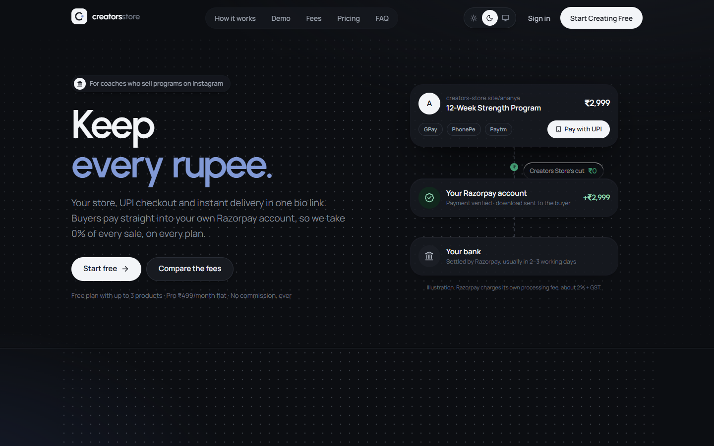
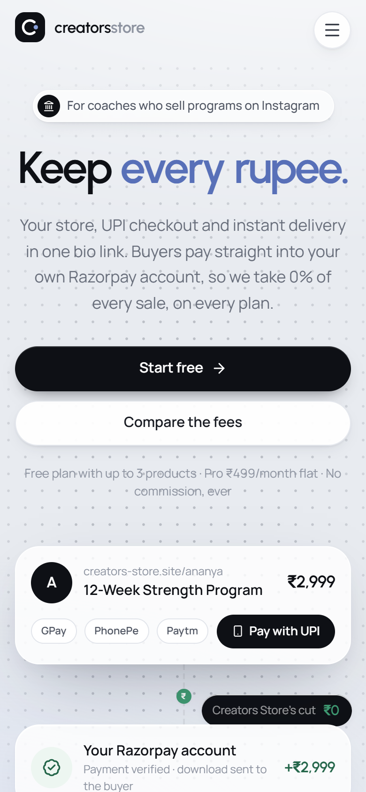

# Creators Store

**Keep every rupee.** A store, UPI checkout and instant delivery for coaches in India who sell programs on Instagram. Buyers pay straight into the coach's own Razorpay account, and the platform takes **0% commission** on every plan.

**Live:** https://www.creators-store.site

**[▶ Watch the walkthrough](https://anuj1102001.github.io/creators-store-showcase/watch.html)** (1 min 53 s, narrated with a synthetic voice): the fee comparison, sign-up, adding a program, connecting Razorpay, a test purchase, the "You kept" dashboard and plans. Recorded on a local build with a test account and a test payment page, so no real money moves.

## Why it's different

Most creator-commerce tools take a percentage of every sale, or collect the money and pay creators out later. Creators Store does neither:

- **The creator's own Razorpay.** Creators connect their Razorpay account once, with a guided setup. Checkout runs on their account, and Razorpay settles to their bank. The platform never holds the money.
- **0% commission.** The platform earns from a flat subscription: Free ₹0 (up to 3 products), Pro ₹499/month, Premium ₹1,499/month (annual billing gives 2 months free).
- **Built for coaches.** Fitness coaches, yoga teachers and nutritionists who sell programs, plans and calls, and are tired of selling in DMs and checking UPI screenshots.

| Home | Fee calculator |
|---|---|
|  |  |

| Dashboard: what you kept | Guided Razorpay setup |
|---|---|
|  |  |

| Plans | Dark mode | Mobile |
|---|---|---|
|  |  |  |

## Features

- **Store builder:** templates, colours, typography, sections, SEO, live mobile/desktop preview, publish/unpublish
- **Products:** programs, digital downloads with private files, coaching, consultations, services, external links
- **Checkout:** UPI, cards, net banking via the creator's Razorpay; orders fulfilled only after server-side verification; instant delivery and receipt emails
- **Payments setup:** step-by-step Razorpay guide with progress, test-mode purchase before going live, keys verified with Razorpay and stored encrypted
- **Reliability:** reconciliation for buyers who close the tab (on page load and a scheduled job); optional per-creator webhooks, treated as hints and re-verified
- **Orders and customers:** refunds, CSV export, customer CRM, newsletter subscribers
- **Analytics:** visitors, sources and UTM, funnel, conversion, revenue, and a "You kept" card comparing ₹0 commission with a 10% platform
- **AI tools (preview):** store drafting, content, campaigns and growth insights are built in, but they run on sample output until a model API key is configured. Until then they sit in a labelled preview section and are not advertised or included in any plan.
- **Admin:** users, subscriptions, GMV, MRR/ARR, churn, system health, error and audit logs
- **Light, dark and match-device themes** across the dashboard and marketing site

## Tech stack

Next.js 15 (App Router, server actions) · React 19 · TypeScript · Tailwind CSS · Motion · PostgreSQL (Neon) · Drizzle ORM · Zod · Razorpay REST API · Resend · Vercel Blob · Vercel (Singapore region)

Security highlights: bcrypt passwords and revocable hashed sessions, Zod validation on every input, CSP/HSTS headers, rate limits, AES-256-GCM encryption for stored payment credentials, idempotent payment handling.

How it fits together: [ARCHITECTURE.md](ARCHITECTURE.md).

## Quality

- 33 automated tests on an in-memory Postgres covering checkout, payment verification, tampered amounts, forged signatures, refunds, webhooks, subscriptions, creator payment connections, the fee comparison and plan display rules
- Full documentation for setup, deployment, operations, customization and handover

## Status

- Live on its own domain; email sending and support inbox working
- End-to-end purchase tested on production in Razorpay test mode
- Early stage: no paying customers yet

## Source code

This repository is a public showcase. The application source is private.

Interested in the product, a partnership or an acquisition? Write to **support@creators-store.site**.

© Creators Store. All rights reserved.
